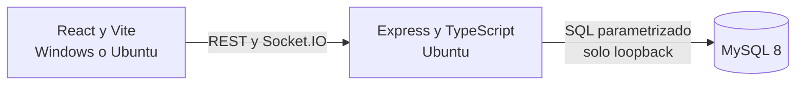
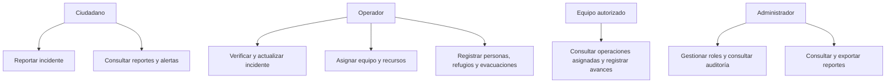

# Arquitectura y pruebas

React controla la navegación, los formularios y la presentación. Express valida las entradas, resuelve el rol activo y delimita las consultas por usuario. MySQL conserva los datos, las sesiones, la auditoría y los historiales. Los cambios de inventario, las asignaciones y sus notificaciones se aplican en una sola transacción cuando corresponden.

## Casos de uso

## Tres incrementos

1. **Fundamentos y emergencias**. Esquema y territorio, cuenta ciudadana, roles, reporte, historial, filtros y mapa.
2. **Gestión operativa**. Seguimiento de personas, equipos, operaciones, recursos, refugios, evacuaciones, contactos y notificaciones.
3. **Integración y entrega**. Indicadores, exportación, scripts de Ubuntu, pruebas y documentación.

## Matriz de comprobación

La suite [integration.test.ts](../backend/tests/integration.test.ts) documenta las entradas y aserciones. `sudo bash ops/test-mysql.sh` genera la evidencia de cada ejecución contra un esquema temporal.

| Código | Comprobación | Evidencia o procedimiento |
| --- | --- | --- |
| PF-01 a PF-04 | Registro, login, rechazo y roles | Vitest y Supertest |
| PF-05 a PF-09 | Alta de incidente, filtros, coordenadas, verificación y estado | Vitest y Supertest. Para PF-07, abrir el mapa y comprobar el marcador con las coordenadas del incidente |
| PF-10 a PF-13 | Personas, seguimientos, equipos y asignación | Vitest y Supertest |
| PF-14 a PF-17 | Recursos, transacciones, refugios y evacuación | Vitest y Supertest |
| PF-18 | Emisión en tiempo real, persistencia y lectura | Socket.IO y Supertest |
| PF-19 | Modal de alerta crítica verificada | Abrir dos sesiones, publicar un simulacro crítico desde la cuenta operadora y comprobar que la cuenta ciudadana ve el modal. Cerrar y recargar para confirmar lectura persistida |
| PF-20 | Reportes y centro | Consultas verificadas por Vitest. Usar Exportar CSV e Imprimir en el navegador para probar la presentación |
| PF-21 | Comunicación frontend y API | Abrir el frontend en Windows, iniciar sesión y consultar los catálogos y registros de Ubuntu |
| PF-22 | Persistencia y FK | Consultas directas de MySQL en Vitest |
| PF-23 | Acceso desde otro equipo | Desde Windows en el adaptador host-only, llamar a /api/v1/health y abrir el frontend |
| PF-24 | Privacidad | Supertest comprueba que perfiles ciudadanos no consultan personas ni reportes pendientes de terceros |
| PF-25 | Disponibilidad tras reiniciar | Registrar un incidente, reiniciar Ubuntu, comprobar servicios activos y volver a consultar por código |

## Resultados observados

- MySQL 8.4.11 en Windows, esquema independiente. Pasaron 17 pruebas automatizadas. Cubren PF-01 a PF-18, las consultas de PF-20, PF-22 y PF-24.
- Chrome en Windows, con frontend Vite y API Express conectada a MySQL. Se verificaron la creación de cuenta, inicio de sesión, registro de emergencia, marcador y ficha, recepción del modal por Socket.IO, lectura tras recargar y exportación CSV.
- Diseño del login comprobado a 1440 × 900 y 390 × 844. Se verificaron la imagen, la visibilidad de contraseña y el cambio a registro sin desbordamiento horizontal.

- UbuntuTrabajo, Ubuntu Desktop 26.04.1 LTS. Pasaron las 17 pruebas con MySQL 8.4.13 en un esquema independiente. El navegador, conectado al servicio de Ubuntu por el puerto 3030 del anfitrión, verificó el registro, inicio de sesión, mapa, alerta crítica y CSV con datos de simulacro.
- Red entre VM, PF-21 y PF-23. Desde win11a, Vite en el puerto 5173 consultó la API en 192.168.56.20:3000. Las solicitudes directa y a través del proxy devolvieron estado ok y conexión a MySQL.
- Persistencia tras reinicio, PF-25. Se comprobó un arranque nuevo de Ubuntu, el inicio automático de MySQL y Express y la recuperación de la emergencia ficticia EM-123BA0281B6B con estado de verificación conservado.
- El modelo ER se analizó correctamente con el parser DBML. Contiene 31 tablas y 46 relaciones.

## Límites del entorno académico

Los contactos, refugios y comunidades deben revisarse antes de incorporar información real. La cartografía representa límites de referencia. El sistema registra evacuaciones gestionadas por personas autorizadas. Las decisiones de atención y las indicaciones públicas corresponden al personal a cargo.
